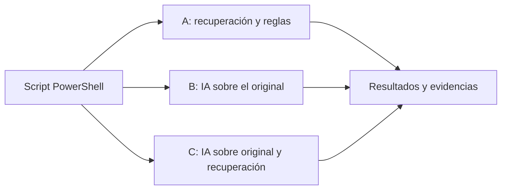

# PowerShell Insight AI

PowerShell Insight AI es una aplicación local para el análisis estático y la desofuscación de scripts PowerShell. Combina técnicas deterministas con modelos de lenguaje para identificar comportamientos relevantes para la seguridad, examinar evidencias y facilitar la interpretación del código.

## Descripción

La codificación, la concatenación de cadenas y otras formas de ofuscación dificultan la lectura de scripts PowerShell. La aplicación recupera contenido mediante transformaciones estáticas y presenta los fragmentos obtenidos junto con su procedencia, sin ejecutar el script.

El análisis con inteligencia artificial aporta una interpretación complementaria del código. La interfaz permite comparar esa interpretación con los resultados del motor determinista, consultar explicaciones y revisar las evidencias citadas. El proyecto surge de la investigación en ciberseguridad y mantiene un carácter experimental.

## Características

- Carga de archivos UTF-8 o edición de texto PowerShell en el navegador.
- Análisis estático sin ejecutar el código proporcionado.
- Recuperación determinista de formas soportadas de Base64, concatenación y variables.
- Identificación de comportamientos mediante reglas y análisis complementario con un LLM.
- Comparación de los enfoques A, B y C en una misma interfaz.
- Visualización de hallazgos, explicaciones, evidencias, recuperaciones e incertidumbres.
- Validación de la literalidad y procedencia de las citas del modelo.
- Exportación explícita de resultados en JSON.

## Cómo funciona

| Enfoque | Descripción |
|---|---|
| **A — Análisis determinista** | Recuperación estática y detección mediante reglas. Funciona sin un LLM. |
| **B — Análisis con IA** | Interpretación del script original mediante un modelo de lenguaje. |
| **C — Análisis con IA y desofuscación** | Interpretación del original acompañado de contenido recuperado y verificado por el motor determinista. |



B y C comparten modelo, política, esquema y parámetros; C añade únicamente la recuperación estática, sin recibir etiquetas del detector ni respuestas de B. El backend procesa el texto y la interfaz React muestra los resultados.

Los comportamientos se organizan en siete categorías, B01–B07: descarga, ejecución dinámica funcional, persistencia, modificación de defensas, reconocimiento, otras comunicaciones de red y acceso a información de credenciales. Sus criterios se describen en la [taxonomía](docs/behavior_taxonomy.md). Detectar un comportamiento no implica que el script sea malicioso.

## Tecnologías

| Componente | Tecnologías |
|---|---|
| Backend | Python, FastAPI y Uvicorn |
| Frontend | React, TypeScript, Vite y CSS propio |
| IA local | Ollama y Qwen3-Coder 30B como perfil definitivo experimental explícito; Qwen14 conserva compatibilidad histórica |
| Validación | Pydantic y comprobación literal de evidencias |
| Pruebas | Pytest, Vitest y Testing Library |

Las dependencias se fijan en [requirements-app.txt](backend/requirements-app.txt), sus requisitos incluidos y [package-lock.json](frontend/package-lock.json).

## Estructura del proyecto

```text
powershell-insight-ai/
├── backend/       # API, motores de análisis, proveedores y pruebas Python
├── frontend/      # Interfaz React, componentes y pruebas de interfaz
├── experiments/   # Configuraciones, controladores y evaluación experimental
├── datasets/      # Textos controlados y metadatos de referencia
├── docs/          # Documentación técnica y metodológica
└── artifacts/     # Evidencias e informes de ejecuciones anteriores
```

## Requisitos previos

El entorno principal documentado es Windows con PowerShell:

- Git.
- Python **3.13**; las dependencias se fijaron con Python 3.13.3.
- Node.js **24** y npm.

La aplicación y el análisis A funcionan sin Ollama ni claves de API. Para B y C se necesita además Ollama en `127.0.0.1:11434`, el modelo configurado y memoria suficiente. Qwen3-Coder CPU requiere **23968709120 bytes (aproximadamente 22,32 GiB) disponibles de RAM y de margen de commit para carga en frío**, incluido el margen de 2 GiB. El backend comprueba recursos; la contabilidad Linux y sus límites cgroup se validan por separado en infraestructura. La verificación local usa transporte simulado y no necesita instalar el modelo.

## Instalación

Ejecutar en PowerShell:

```powershell
git clone --branch develop https://github.com/Eliza-05/powershell-insight-ai.git
cd powershell-insight-ai
py -3.13 -m venv .venv
.\.venv\Scripts\Activate.ps1
.\.venv\Scripts\python.exe -m pip install -r backend/requirements-app.txt
npm.cmd --prefix frontend ci
```

Si PowerShell bloquea la activación, se puede continuar usando directamente `.\.venv\Scripts\python.exe`, como en los comandos de esta guía. No es necesario modificar la política de ejecución.

El arranque predeterminado no requiere variables de entorno ni carga `.env` automáticamente. [.env.example](.env.example) describe la configuración disponible; las opciones avanzadas se explican en la [guía del prototipo](docs/prototype_exploratory.md).

Para comprobar las dependencias Python:

```powershell
.\.venv\Scripts\python.exe -m pip check
```

## Ejecución

Desde la raíz del repositorio, abrir dos terminales.

**1. Iniciar el backend:**

```powershell
$env:PSI_LLM_PROFILE = 'qwen3coder-v2'
.\.venv\Scripts\python.exe -B -m uvicorn app.main:app --app-dir backend --host 127.0.0.1 --port 8000 --no-access-log
```

**2. Iniciar el frontend:**

```powershell
npm.cmd --prefix frontend run dev
```

**3. Abrir [http://127.0.0.1:5173](http://127.0.0.1:5173).** El frontend redirige las solicitudes `/api` al backend en el puerto 8000. Detener cada proceso con Ctrl+C en su terminal.

Para comprobar los servicios sin generar inferencias:

```powershell
Invoke-RestMethod http://127.0.0.1:8000/api/health
Invoke-RestMethod http://127.0.0.1:8000/api/capabilities
Invoke-RestMethod http://127.0.0.1:8000/api/provider/status
```

La salud de la API debe indicar `status=ok` y `static_only=true`. El proveedor puede aparecer como no disponible sin impedir el uso de A. El arranque y las consultas de estado no cargan el modelo ni generan respuestas de IA.

A es el modo inicial de la interfaz. Pegar o cargar texto no inicia un análisis; este comienza al pulsar el botón correspondiente. B y C requieren Ollama disponible, y comparar A/B/C solicita ambos análisis con IA.

### Interfaz compilada

También es posible servir la aplicación desde FastAPI sin mantener Vite en ejecución:

```powershell
npm.cmd --prefix frontend run build
.\.venv\Scripts\python.exe -B -m uvicorn app.main:app --app-dir backend --host 127.0.0.1 --port 8000 --no-access-log
```

Construir antes de iniciar el backend y abrir [http://127.0.0.1:8000](http://127.0.0.1:8000).

## Configuración de modelos

B y C utilizan **`qwen3-coder:30b` mediante Ollama** al definir `PSI_LLM_PROFILE=qwen3coder-v2` en el entorno del proceso. Es la selección experimental del equipo, no una certificación científica. Si se omite la variable se conserva el perfil histórico `qwen2.5-coder:14b`; valores desconocidos se rechazan. `.env` no se carga automáticamente.

Consultar modelos instalados y residentes no genera inferencias:

```powershell
ollama list
ollama ps
```

La validación local no descarga modelos ni llama al proveedor real. La instancia de evaluación deberá disponer del modelo y digest autorizados antes de una ejecución expresamente aprobada.

Los pesos se almacenan en la ubicación configurada por Ollama y no deben añadirse al repositorio. El backend verifica el modelo y su digest esperado; si no coinciden o faltan recursos, informa la indisponibilidad sin cambiar automáticamente de modelo. `/api/capabilities` permite consultar el perfil configurado.

Para opciones avanzadas mediante `PSI_PIPELINE_SETTINGS`, consultar la [guía del prototipo](docs/prototype_exploratory.md). El perfil estándar fija modelo, digest y puerto; cambiar de proveedor requiere una integración explícita. Existe trabajo experimental con Gemini Developer API, separado del proveedor predeterminado, descrito en la [documentación de Gemini](docs/gemini_viability.md).

## Pruebas

Para la verificación integrada sin inferencias, comandos seguros, entorno Linux y preparación prospectiva del FREEZE, consultar [integración local final](docs/final_local_integration.md). No ejecutar toda la suite científica como prueba ordinaria: algunos controladores generan propuestas o congelaciones en sus fixtures.

Desde la raíz, con las dependencias instaladas:

```powershell
$psiTestTemp = Join-Path $env:TEMP ('psi-tests-' + [guid]::NewGuid().ToString('N'))
.\.venv\Scripts\python.exe -B -m pytest -q -p no:cacheprovider backend/tests --basetemp "$psiTestTemp" --tb=short
npm.cmd --prefix frontend test -- --cache=false --fsModuleCache=false --configLoader=runner
```

Las pruebas de B/C utilizan respuestas simuladas, sin inferencias reales. Con el backend activo en el puerto 8000, se puede ejecutar la integración de interfaz y API, que usa únicamente A:

```powershell
npm.cmd --prefix frontend run test:integration -- --cache=false --fsModuleCache=false --configLoader=runner
```

## Documentación

- [Arquitectura](docs/architecture.md): componentes y flujo de información.
- [Taxonomía B01–B07](docs/behavior_taxonomy.md): criterios de los comportamientos identificados.
- [Motor de desofuscación](docs/deobfuscator.md): transformaciones admitidas y límites.
- [Guía del prototipo](docs/prototype_exploratory.md): ejecución y configuración del perfil de IA.
- [Metodología](docs/methodology.md): diseño de la evaluación experimental.
- [Desarrollo](docs/development.md): convenciones de código y contribución.

## Consideraciones de seguridad

- El análisis es exclusivamente estático. No ejecutar los scripts analizados ni el contenido recuperado o generado.
- El motor cubre un subconjunto de PowerShell; una salida sin hallazgos no demuestra benignidad.
- Los resultados del LLM pueden contener errores. Una cita literal y una procedencia válidas no garantizan que la interpretación sea correcta; las respuestas que incumplen el contrato o las comprobaciones de evidencia se rechazan.
- La aplicación es experimental y no sustituye herramientas de seguridad validadas ni revisión humana.
- Mantener los servicios en loopback y las credenciales fuera del repositorio y del frontend. No enviar muestras confidenciales a servicios externos.
