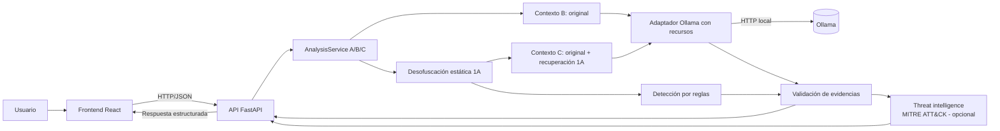

# Arquitectura del proyecto

> Estado implementado: pilotos históricos conservados, motores 1A/1B y servicios de aplicación A/B/C de la Fase 2 con Qwen3.5 provisional. La autorización prospectiva DEV-03 permite desarrollo sin aprobar la calidad del modelo. [Arquitectura y contratos de Fase 2](phase2_integration.md), [resultados y estado real](phase2_closure.md). FastAPI/React y la evaluación científica A/B/C siguen pendientes.

## 1. Visión general

La aplicación sigue una arquitectura cliente-servidor local. El navegador solo presenta información; todo el procesamiento ocurre en el backend, y el LLM se ejecuta en la misma máquina mediante Ollama. No se contempla infraestructura cloud, base de datos ni contenedores en esta etapa.

## 2. Flujo de información

1. El usuario carga o pega un script en el frontend.
2. El frontend envía el texto a la API. El script **nunca se ejecuta**, ni en el navegador ni en el servidor.
3. La API valida la entrada (tamaño, codificación) con esquemas Pydantic.
4. El motor de desofuscación aplica transformaciones estáticas y produce artefactos recuperados, cada uno con su trazabilidad (posición original y transformación aplicada).
5. El motor de detección aplica reglas deterministas sobre el script original y los artefactos, y genera hallazgos según la [taxonomía de comportamientos](behavior_taxonomy.md).
6. Según la configuración experimental, el servicio LLM construye el prompt (script original, y opcionalmente artefactos recuperados) y solicita a Ollama una respuesta estructurada.
7. El validador exige JSON completo y citas literales en el origen declarado. No certifica que la cita sustente semánticamente la afirmación; los resultados LLM quedan sin revisión semántica. C nunca recibe las etiquetas del detector.
8. Opcionalmente, los comportamientos se relacionan con técnicas MITRE ATT&CK.
9. La API devuelve una respuesta estructurada al frontend.

## 3. Módulos y responsabilidades

### Frontend (`frontend/`)
- **Responsable de:** carga de scripts, visualización de código (Monaco, candidato), presentación de hallazgos, evidencias resaltadas y resultados experimentales.
- **Límites:** no contiene lógica de desofuscación ni de detección, no almacena credenciales y no ejecuta código del usuario. Se comunica con el backend solo a través de `src/services/`.

### API (`backend/app/api/`)
- **Responsable de:** exponer endpoints REST, validar entradas/salidas y orquestar los servicios.
- **Límites:** no implementa lógica de análisis; delega en `services/`.

### Núcleo (`backend/app/core/`)
- **Responsable de:** configuración (lectura de variables de entorno), constantes, límites de procesamiento y utilidades compartidas.

### Esquemas (`backend/app/schemas/`)
- **Responsable de:** contratos de datos con Pydantic (solicitud de análisis, artefacto recuperado, hallazgo, evidencia, respuesta del LLM). Estos contratos permiten que el frontend avance en paralelo.

### Desofuscación (`backend/app/services/deobfuscation/`)
- **Implementado:** API Python `deobfuscate`, lexer y gramática limitada, Base64 de lanzador/inline, concatenación literal y sustitución conservadora de variables. Las capas y transformaciones conservan rangos, dependencias y procedencia. `OT-FORMAT` se detecta sin resolver; no hay normalización global ni reescritura del script.
- **Límites:** nunca invoca PowerShell, red ni expresiones arbitrarias; aplica cotas de tamaño, profundidad, expansión, número de registros y presupuesto determinista de trabajo. No depende de FastAPI ni del LLM. Un plazo de reloj externo corresponde al futuro servicio, no cambia las decisiones deterministas del motor. Contratos y alcance exacto en [deobfuscator.md](deobfuscator.md).

### Detección (`backend/app/services/behavior_detection/`)
- **Implementado:** API Python `analyze_behaviors`, doce reglas para subconjuntos B01–B07, extracción de invocaciones sobre el lexer existente, condiciones contextuales, hallazgos con citas verificables, indicios separados y deduplicación por identidad de operación. Conserva el resultado completo de 1A y sus dependencias. [Contrato y cobertura](behavior_detector.md).
- **Límites:** no ejecuta texto, consulta ground truth ni usa el LLM. No produce riesgo o veredictos de maliciosidad. EncodedCommand y `&` no generan B02; los wrappers IEX declarados se excluyen y la procedencia funcional desconocida se comunica. Las relaciones no probadas y OT-FORMAT producen abstenciones. Se aplican presupuestos deterministas y cotas de hallazgos/evidencias. La aprobación de 1B acepta ese alcance y los FN P3/P7; no equivale a una evaluación experimental independiente de A.

### LLM (`backend/app/services/llm/`)
- **Histórico conservado:** cliente y contratos de los pilotos. La aplicación utiliza los módulos separados de `services/pipelines/`, sin modificar prompts o resultados congelados.

### Aplicación A/B/C (`backend/app/services/pipelines/`)
- **Implementado:** entrada, configuración, política compartida y contextos aislados, adaptador HTTP local, controles de RAM/compromiso/concurrencia/timeout, validación de JSON/evidencias, orquestador independiente de framework, CLI y persistencia explícita sin sobrescritura. [Detalle](phase2_integration.md).
- **Límites:** A no usa Ollama; B no desofusca; C usa solo 1A. No se ejecutan muestras. El modelo es provisional y puede producir afirmaciones falsas que superen la validación literal; el estado `completed` es operativo.

### Evidencias (`backend/app/services/evidence/`)
- **Responsable de:** utilidades históricas de localización literal. La validación de aplicación reside en `pipelines/validation.py`; comprueba presencia y procedencia, sin convertir citas existentes en adjudicación semántica.

### Threat intelligence (`backend/app/services/threat_intelligence/`)
- **Responsable de:** mapeo opcional a MITRE ATT&CK a partir de datos STIX 2.1 descargados localmente.
- **Límites:** módulo opcional; el sistema debe funcionar sin él.

### Experimentos (`experiments/`)
- **Responsable de:** ejecutar las configuraciones A/B/C sobre el dataset de evaluación y calcular métricas. Reutiliza los servicios del backend sin pasar por la API. Ver [methodology.md](methodology.md).

## 4. Decisiones de diseño

- **Servicios independientes del framework:** los motores de análisis son módulos Python puros; FastAPI solo los expone. Esto permite reutilizarlos en experimentos y probarlos con Pytest.
- **LLM local:** evita enviar muestras potencialmente sensibles a servicios externos y favorece la reproducibilidad (versión de modelo fija).
- **Respuestas estructuradas:** el LLM debe responder en un formato validado por Pydantic para poder medir resultados y verificar evidencias.
- **Persistencia explícita:** no hay base de datos; `save_result` escribe un JSON nuevo solo cuando el consumidor lo solicita. Los artefactos funcionales de Fase 2 están en `artifacts/phase2/`; los resultados históricos de `experiments/results/` se conservan.
