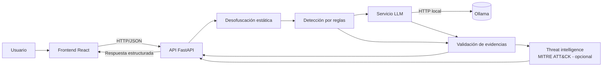

# Arquitectura prevista

> Documento de diseño. Ningún componente descrito aquí está implementado todavía.

## 1. Visión general

La aplicación sigue una arquitectura cliente-servidor local. El navegador solo presenta información; todo el procesamiento ocurre en el backend, y el LLM se ejecuta en la misma máquina mediante Ollama. No se contempla infraestructura cloud, base de datos ni contenedores en esta etapa.

## 2. Flujo de información

1. El usuario carga o pega un script en el frontend.
2. El frontend envía el texto a la API. El script **nunca se ejecuta**, ni en el navegador ni en el servidor.
3. La API valida la entrada (tamaño, codificación) con esquemas Pydantic.
4. El motor de desofuscación aplica transformaciones estáticas y produce artefactos recuperados, cada uno con su trazabilidad (posición original y transformación aplicada).
5. El motor de detección aplica reglas deterministas sobre el script original y los artefactos, y genera hallazgos según la [taxonomía de comportamientos](behavior_taxonomy.md).
6. Según la configuración experimental, el servicio LLM construye el prompt (script original, y opcionalmente artefactos recuperados) y solicita a Ollama una respuesta estructurada.
7. El validador de evidencias comprueba que cada afirmación del LLM esté respaldada por fragmentos que existan realmente en el script o en los artefactos recuperados, y marca las afirmaciones no respaldadas.
8. Opcionalmente, los comportamientos se relacionan con técnicas MITRE ATT&CK.
9. La API devuelve una respuesta estructurada al frontend.

## 3. Módulos y responsabilidades

### Frontend (`frontend/`)
- **Responsable de:** carga de scripts, visualización de código (Monaco, candidato), presentación de hallazgos, evidencias resaltadas y resultados experimentales.
- **Límites:** no contiene lógica de desofuscación ni de detección, no almacena credenciales y no ejecuta código del usuario. Se comunica con el backend solo a través de `src/services/`.

### API (`backend/app/api/`)
- **Responsable de:** exponer endpoints REST, validar entradas/salidas y orquestar los servicios.
- **Límites:** no implementa lógica de análisis; delega en `services/`.

### Núcleo (`backend/app/core/`)
- **Responsable de:** configuración (lectura de variables de entorno), constantes, límites de procesamiento y utilidades compartidas.

### Esquemas (`backend/app/schemas/`)
- **Responsable de:** contratos de datos con Pydantic (solicitud de análisis, artefacto recuperado, hallazgo, evidencia, respuesta del LLM). Estos contratos permiten que el frontend avance en paralelo.

### Desofuscación (`backend/app/services/deobfuscation/`)
- **Responsable de:** transformaciones estáticas controladas (p. ej., decodificación Base64, resolución de concatenaciones, normalización de mayúsculas/acentos graves, reordenamiento de formato).
- **Límites:** nunca invoca PowerShell ni evalúa expresiones arbitrarias; aplica límites de profundidad, tamaño y tiempo. Debe poder usarse sin FastAPI.

### Detección (`backend/app/services/detection/`)
- **Responsable de:** reglas deterministas que asignan comportamientos funcionales (B01–B07) con evidencia localizada, y registro separado de las técnicas de ofuscación detectadas.
- **Límites:** produce hallazgos, no veredictos de maliciosidad. Los envoltorios de ejecución añadidos por la ofuscación no generan comportamientos.

### LLM (`backend/app/services/llm/`)
- **Responsable de:** cliente de Ollama, plantillas de prompt versionadas, parámetros de inferencia (temperatura, semilla), parseo y validación de la salida estructurada.
- **Límites:** trata el contenido del script como dato no confiable; no sigue instrucciones contenidas en el script. Registra modelo y versión usados.

### Evidencias (`backend/app/services/evidence/`)
- **Responsable de:** verificar que cada hallazgo (de reglas o del LLM) cite fragmentos existentes, y clasificar afirmaciones como respaldadas o no respaldadas.

### Threat intelligence (`backend/app/services/threat_intelligence/`)
- **Responsable de:** mapeo opcional a MITRE ATT&CK a partir de datos STIX 2.1 descargados localmente.
- **Límites:** módulo opcional; el sistema debe funcionar sin él.

### Experimentos (`experiments/`)
- **Responsable de:** ejecutar las configuraciones A/B/C sobre el dataset de evaluación y calcular métricas. Reutiliza los servicios del backend sin pasar por la API. Ver [methodology.md](methodology.md).

## 4. Decisiones de diseño

- **Servicios independientes del framework:** los motores de análisis son módulos Python puros; FastAPI solo los expone. Esto permite reutilizarlos en experimentos y probarlos con Pytest.
- **LLM local:** evita enviar muestras potencialmente sensibles a servicios externos y favorece la reproducibilidad (versión de modelo fija).
- **Respuestas estructuradas:** el LLM debe responder en un formato validado por Pydantic para poder medir resultados y verificar evidencias.
- **Sin persistencia por ahora:** no se define base de datos; los resultados experimentales se guardan como archivos en `experiments/results/`.
