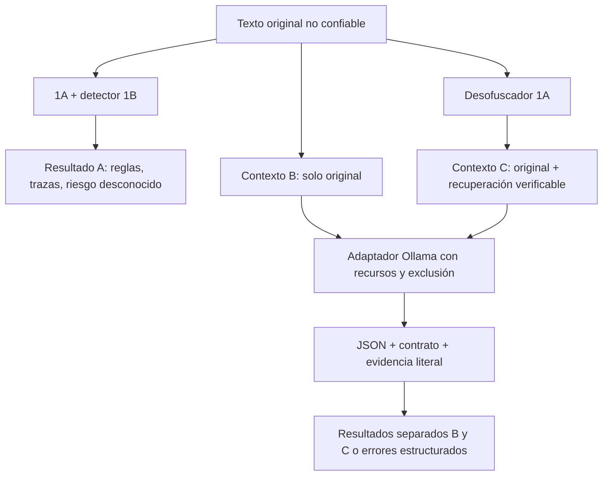

# Fase 2: integración local A/B/C

Fecha de la autorización: **2026-11-02 (America/Bogota)**. Modelo experimental provisional
único: `qwen3.5:4b-q4_K_M`, digest
`d8b0f5e9760cd1682034f292d7ef72ec46f432149be0df7574bf2d6e92e38c04`.
El estado y los resultados reales de entrega se registran en [phase2_closure.md](phase2_closure.md).

## Decisión metodológica prospectiva DEV-03

El responsable autorizó expresamente implementar toda la Fase 2 antes de concluir la validación
de calidad del LLM. Esta excepción modifica **solo la dependencia de desarrollo** de DEV-01;
no aprueba Qwen3.5, no modifica umbrales ni concede aprobación retrospectiva al piloto.
La instrucción recibida autoriza hasta seis inferencias funcionales locales con ejemplos
sintéticos nuevos, condicionadas a recursos, y prohíbe nuevas ejecuciones de selección.

El piloto v2 sigue **PENDIENTE / INCONCLUSO**: 58 llamadas intentadas, 68 de selección pendientes,
r0/r1 conservados, hashes/umbrales congelados y parada por compromiso disponible de 1,94 GiB.
Se mantienen sus limitaciones de calidad y la ausencia de adjudicación humana individual.
No se usan S01–S24, sus respuestas ni los futuros casos finales para ajustar software/prompts.
Las actas históricas describen correctamente su momento y se conservan sin cambios. Este
documento registra la autorización posterior; no reescribe las decisiones históricas.

## Arquitectura implementada

Los módulos de aplicación viven en `backend/app/services/pipelines/`; no requieren FastAPI,
React, el SDK de Ollama ni importaciones de los ejecutores/datasets del piloto. Reutilizan
los motores y contratos de 1A/1B y los enums de la taxonomía existente. Los antiguos servicios
`llm/` y contratos del piloto se conservan: no satisfacían por sí solos aislamiento C, control
de recursos, truncamientos y procedencia de la nueva aplicación.

| Componente | Responsabilidad |
|---|---|
| `schemas/pipeline.py` | Contratos Pydantic versionados, procedencias y coherencia de resultados |
| `pipelines/config.py` | Configuración inmutable, opciones B/C y mínimos de recursos |
| `pipelines/context.py` | Política común, contexto original B y lista permitida de trazas 1A para C |
| `pipelines/policy_v1.md` | Prompt de aplicación separado, referencia conceptual al desarrollo r1 |
| `pipelines/validation.py` | JSON estricto, esquema y localización literal de citas |
| `pipelines/ollama.py` | Adaptador sustituible, HTTP loopback, disponibilidad/digest, petición y métricas |
| `pipelines/resources.py` | RAM/compromiso Windows, exclusión entre procesos e interrupción preventiva |
| `pipelines/service.py` | Entrada y orquestación independiente A/B/C |
| `pipelines/serialization.py` | Serialización y persistencia explícita sin sobrescritura |
| `pipelines/__main__.py` | CLI Python para texto UTF-8 y estado local |
| `experiments/check_phase2.py` | Comprobación funcional explícita, dos llamadas nuevas por ejecución |



C llama únicamente a `deobfuscate`, nunca a `analyze_behaviors`. Su constructor recibe
`DeobfuscationResult`, no `BehaviorAnalysisResult`. La proyección contiene texto verificado,
identificador, técnica, tipo de recuperación, coordenadas de origen/raíz, fragmento original,
dependencias, advertencias y elementos no resueltos. No recibe reglas, etiquetas, decisiones,
riesgos, referencias privadas, anotaciones o ground truth. Los valores de tipo bytes parciales
no se presentan como texto recuperado. No se reclama equivalencia ni alcanzabilidad.

B/C comparten exactamente política, esquema, configuración, digest obligatorio y opciones.
Cada llamada construye dos mensajes nuevos; nunca envía respuestas previas. La diferencia es
únicamente el objeto adicional `deterministic_recovery` de C. Ollama puede reutilizar caché de
prefijo del motor, pero la aplicación no conserva conversación ni comparte resultados.
`compare` ejecuta A, B, C en orden y conserva tres estados, UUID, duraciones y procedencias;
no calcula calidad comparativa ni elige una respuesta ganadora.

## Contratos y atribución

`PipelineResult` (`pipeline-v1`) incluye configuración, estado, UUID, fecha UTC, duración,
SHA-256 UTF-8 y texto original; versiones; trazas completas 1A; resultado 1B exclusivo de A;
reporte LLM exclusivo de B/C; citas localizadas; riesgo, limitaciones y errores estructurados.
`ComparisonResult` exige A/B/C, UUID distintos y el mismo hash de entrada.

Estados: `completed` significa ejecución y comprobaciones estructurales terminadas;
`partial` conserva recuperación/detección incompleta; `rejected` corresponde a entrada
inválida; `unavailable` a recursos/modelo/servicio/bloqueo; `error` a fallo de respuesta u otro
error. Un análisis parcial o sin etiquetas no establece ausencia de comportamiento ni seguridad.

A conserva las evidencias, reglas, indicadores, condiciones, límites y spans de 1A/1B y siempre
mantiene riesgo `unknown`: observar comportamiento no determina intención. Los B01–B07 se
obtienen de `deterministic.behaviors` en A y `llm.behaviors` en B/C, sin mezclar autores.

El JSON LLM usa `ModelReport`: técnicas, reconstrucciones declaradas, comportamientos
multietiqueta (cero a siete, sin duplicados), explicación/confianza/evidencias, riesgo y su
justificación, incertidumbre, prompt injection y limitaciones. Cada cita declara `source_id`
(`original` o un ID real de transformación) y `snippet`. Se comprueban caracteres exactos,
origen y unicidad y se añaden offsets, línea/columna, raíz y transformación. Una cita repetida
ambiguamente exige más contexto; no se asigna una coordenada inventada.

Las reconstrucciones propias del modelo se conservan como **no verificadas** en
`llm.recovered_content` y no pueden respaldar evidencia. Las de 1A permanecen separadas en
`deobfuscation`. Un rechazo conserva respuesta cruda y errores, publica `llm=null`, cero citas
aceptadas y riesgo `unknown`. No hay extracción de bloques Markdown, reparación, sustitución
de IDs, reintentos ni una segunda llamada al modelo para corregir su salida.

**Límite esencial:** una cita literal puede no sustentar el comportamiento que el modelo le
atribuye. La aplicación NO certifica soporte semántico, legitimidad ni ausencia de alucinaciones.
Lo expresa en `llm_review_status=unreviewed_model_claims`, cada evidencia y las limitaciones.
Las pruebas con mocks verifican transporte/contratos, no precisión del modelo. El control
estructural impide `high_risk` sin combinación de al menos dos etiquetas y `benign` con
incertidumbre distinta de baja o fragmentos desconocidos, pero no sustituye revisión semántica.
El riesgo de B/C conserva explícitamente la autoría del modelo provisional.

## Configuración y uso local

Entorno Windows existente, Python 3.13, Pydantic 2.14.2, Pytest 9.2.0 y Ollama 0.40.13 en la
comprobación local. No se instalaron paquetes ni modelos. Para un entorno nuevo se puede usar
el archivo fijado existente `backend/requirements-pilot.txt`; la integración usa biblioteca
estándar y Pydantic. Ollama debe estar iniciado por el usuario con el modelo autorizado ya
instalado; la aplicación no inicia servicios, descarga modelos ni cambia opciones globales.

Desde la raíz:

```powershell
$env:PYTHONPATH = (Join-Path (Get-Location) 'backend')
.\.venv\Scripts\python.exe -B -m app.services.pipelines --status
.\.venv\Scripts\python.exe -B -m app.services.pipelines --configuration A --input .\mi_muestra.ps1.txt
.\.venv\Scripts\python.exe -B -m app.services.pipelines --configuration B --input .\mi_muestra.ps1.txt --output .\resultado_B_nuevo.json
.\.venv\Scripts\python.exe -B -m app.services.pipelines --configuration C --input .\mi_muestra.ps1.txt --output .\resultado_C_nuevo.json
.\.venv\Scripts\python.exe -B -m app.services.pipelines --configuration ABC --input .\mi_muestra.ps1.txt --output .\comparacion_nueva.json
```

Los comandos ejecutan Python; el archivo analizado solo se lee. No se introduce su texto
en argumentos de procesos ni se invoca PowerShell para analizarlo. CLI devuelve 0 para
ejecución completa/parcial y 2 para error/indisponibilidad. A funciona sin consultar Ollama.
`--output` exige un archivo nuevo y directorio existente. Sin esa opción emite JSON por stdout.
Los resultados contienen el texto y respuesta del modelo: el consumidor controla su almacenamiento.
No hay registro automático de muestras en logs, base de datos o servicios externos.

`--settings archivo.json` acepta exclusivamente `PipelineSettings`; no usa configuraciones
históricas del piloto ni carga `.env` implícitamente. Ejemplo de variación operativa local:

```json
{"timeout_seconds": 180, "max_input_bytes": 32768, "options": {"num_thread": 8}}
```

Opciones por defecto: temperatura 0, seed 42, contexto 8192, salida 2048, CPU (`num_gpu=0`),
10 hilos, batch 256, draft 0, repeat penalty 1, presence/frequency penalty 0, top_k 20,
top_p 0,95, min_p 0. `think=false`, `stream=false`, `truncate=false`, keep_alive 5 min.
Modelo y digest quedan fijados al único candidato autorizado; las interfaces de transporte
y adaptador son sustituibles para desacoplar proveedor, pero no se agregan candidatos.

Se registra versión y hash SHA-256 del texto exacto de la política transmitida (UTF-8 con LF),
hash del esquema, contexto y petición canónicos; mensajes, opciones solicitadas, versión de
Ollama, digest instalado, residentes antes/después, thinking anunciado/observado, contadores,
tiempos nativos en nanosegundos y duración de pared en segundos, truncamientos y errores.
`/api/ps` verifica contexto y CPU efectivos. La API no devuelve todas las opciones de muestreo:
se registran como solicitadas/aceptadas, sin afirmar verificación independiente de cada una.

## Límites y recursos

Entrada de servicio: máximo 65.536 bytes UTF-8 por defecto, configurable hasta 1 MiB,
rechazo sin copiar textos sobredimensionados; entrada vacía/tipos incorrectos/surrogates
inválidos producen errores estructurados. La CLI limita la lectura antes de decodificar.
Los motores conservan además sus cotas existentes de expansión, profundidad, tokens y trabajo.

B/C aplican una cota **conservadora de un token por byte UTF-8** a mensajes y esquema,
512 tokens de reserva de formato y la salida máxima. Si no caben en contexto, rechazan
antes de inferir, sin cortar original ni evidencia. Esto admite textos mucho menores que el
tope de archivo; C puede superar el contexto aun cuando B quepa, por sus trazas adicionales.
Es una limitación deliberada documentada, no un tokenizador exacto. `truncate=false` exige
rechazo del servidor antes que truncamiento; los conteos reales se registran y comprueban al
terminar. La respuesta HTTP se limita a 2 MiB y exige UTF-8 y JSON estrictos, sin claves
duplicadas, NaN o infinitos. `done=true` y `done_reason=stop` son obligatorios.

Solo HTTP nativo hacia `127.0.0.1` (puerto configurable, 11434 por defecto), rutas fijas
`version/tags/ps/show/chat`; no proxies, redirects, pull, herramientas ni URLs de las muestras.
Antes de inferir: disponibilidad, digest exacto, ausencia de otro modelo residente y soporte
anunciado de `think=false`. No descarga/carga modelos diferentes ni descarga residentes.

RAM y compromiso disponible se miden mediante `GlobalMemoryStatusEx`, sin CIM ni cambios
globales. Se exige margen libre de **2 GiB** más reserva: **8 GiB antes de una carga/reconfiguración**
(10 GiB en total) o **1 GiB de crecimiento si el mismo contexto ya está cargado** (3 GiB total).
Los valores pueden aumentarse, nunca reducirse por debajo de los mínimos. La reserva en frío
es mayor que los 6 GiB estimados en el piloto y considera su incidencia de compromiso.

Se muestrea antes, al empezar, cada segundo y al terminar. Si RAM o compromiso cae por debajo
de 2 GiB o falla el colector, se cancela el socket y se invalida la respuesta. El muestreo no
garantiza detectar picos entre intervalos ni reserva memoria frente a otras aplicaciones.
Timeout absoluto de 300 s por defecto (máximo 300), además del timeout de socket; sin reintentos.

Un lock de hilo más un byte lock del sistema operativo impide inferencias simultáneas entre
instancias de esta aplicación para el mismo usuario/directorio temporal. No controla clientes
Ollama externos: la operación requiere evitar inferencias ajenas simultáneas; no se cierran apps.
Después de una interrupción de transporte/timeout/recursos tras despacho se deja una marca
persistente `%TEMP%\powershell-insight-phase2-inference.blocked`. El cierre del socket no prueba
cancelación completa en el servidor: nuevas llamadas se bloquean, A sigue funcionando.
El usuario debe comprobar que no existe una inferencia pendiente y restablecer Ollama si hace
falta antes de retirar esa marca concreta; no hay eliminación ni recuperación automática.
El lock `.lock` persistente es normal y no se debe borrar mientras haya procesos activos.

## Seguridad y pruebas

Nunca se ejecutan muestras, código decodificado o salidas LLM, ni se visitan destinos de las
muestras. No existen subprocess/eval/exec en el nuevo servicio; no se usa parser PowerShell.
No se desactivan protecciones, cambian configuraciones globales o cierran aplicaciones.
El aislamiento de roles y las instrucciones comunes reducen prompt injection, pero no garantizan
inmunidad de un LLM; una respuesta estructuralmente válida sigue siendo una predicción sin revisar.

Pruebas automatizadas desde raíz (no hacen inferencias):

```powershell
$phase2Temp = Join-Path $env:TEMP ('ps-insight-phase2-' + [guid]::NewGuid().ToString('N'))
.\.venv\Scripts\python.exe -B -m pytest -q -p no:cacheprovider backend/tests --basetemp "$phase2Temp" --tb=short
```

El directorio temporal único evita el `PermissionError` del directorio compartido de Pytest
observado en la primera invocación de esta entrega. No fue un fallo de los servicios.
La suite nueva usa fixtures propios/mocks y servidores loopback sintéticos, prueba A sin LLM,
B/C y sus contextos, igualdad de parámetros, aislamiento, multietiqueta, B02, casos negativos,
incertidumbre/inyección, citas falsas, JSON/esquema inválidos, truncamientos, indisponibilidad,
RAM/compromiso, cancelación, timeout, tamaño, exclusión entre procesos, serialización y CLI.
No se invoca el ejecutor del piloto ni se hacen inferencias desde Pytest.

Comprobación real explícita (dos llamadas por comando; no ejecutarlos de nuevo para reproducir
el cierre sin nueva autorización que cubra ese presupuesto):

```powershell
.\.venv\Scripts\python.exe -B experiments/check_phase2.py --example encoded-query --out-dir artifacts/phase2/otra_prueba_encoded
.\.venv\Scripts\python.exe -B experiments/check_phase2.py --example literal-concat --out-dir artifacts/phase2/otra_prueba_concat
.\.venv\Scripts\python.exe -B experiments/check_phase2.py --example unknown-command --out-dir artifacts/phase2/otra_prueba_unknown
```

Cada ejecución exige directorio nuevo, guarda estado, fuente sintética, A, intentos B/C,
peticiones, respuestas, muestras de memoria y resumen. Sin reintentos. El cierre conserva
también los rechazos: no selecciona solo salidas favorables ni convierte fallos en aciertos.

## Limitaciones y fases siguientes

1A conserva el subconjunto estático y los límites de [deobfuscator.md](deobfuscator.md):
`-f` sin resolver, flujos/datos complejos y texto opaco pueden impedir recuperar contenido.
1B conserva doce reglas parciales y sus abstenciones/FN conocidos P3/P7; no se amplió su
catálogo ni se corrigió basándose en resultados reservados. IEX sobre WebClient.DownloadString
inmediato tiene soporte; otras relaciones, p. ej. IEX sobre Invoke-WebRequest, pueden abstenerse.
Test-NetConnection pertenece al subconjunto; Test-Connection no se agrega automáticamente.

Qwen3.5 puede inventar reconstrucciones/efectos, confundir B02, ignorar contexto o citar un
origen incorrecto. Los resultados funcionales de esta entrega no resuelven esos defectos ni
demuestran H1/H2. Validación de calidad del modelo y evaluación A/B/C siguen pendientes.

Fase 3: envolver `AnalysisService` en un worker acotado; FastAPI no debe bloquear su event loop;
mantener lock/circuito y límites, mapear estados a API, generar tipos de los esquemas Pydantic,
escapar todo código/salida al renderizar React y mostrar procedencia, incertidumbre y estado
sin transformar `completed` en validación científica. Definir privacidad/retención si se persiste
entrada sensible. No se implementaron endpoints ni frontend en esta entrega.

Fase 4: decisión explícita sobre validación pendiente del modelo; familias nuevas independientes,
particiones/ground truth y revisión humana registrados, congelación de software/prompts/opciones,
presupuesto contextual comparable sin eliminación selectiva de casos, hardware estable,
adjudicación semántica de citas y métricas por categoría/familia con denominadores claros.
Ni el piloto inconcluso ni estos ejemplos de desarrollo sirven como reserva final independiente.

Referencias técnicas primarias para el transporte y sus campos:
[API oficial de Ollama](https://github.com/ollama/ollama/blob/main/docs/api.md) y
[contratos oficiales](https://github.com/ollama/ollama/blob/main/api/types.go).
La compatibilidad efectiva corresponde al Ollama local registrado, no a una suposición sobre
versiones futuras de la documentación.
