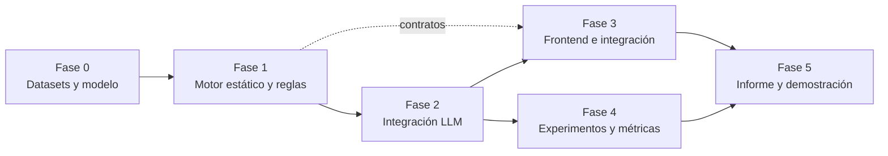

# Hoja de ruta

> No se fijan fechas. El cronograma debe ajustarse a las fechas oficiales del curso. La inicialización del repositorio (estructura y documentación) es el punto de partida y precede a la Fase 0.

## Fase 0 — Validación de datasets y modelo

- **Objetivo:** confirmar que los datos y el modelo candidatos son viables.
- **Actividades:**
  - Inspeccionar las [fuentes candidatas](dataset_sources.md) en un entorno aislado (licencia, formato, volumen, duplicados).
  - Seleccionar fuentes y definir el procedimiento de etiquetado.
  - Revisar y congelar la versión 1 de la [taxonomía](behavior_taxonomy.md).
  - Instalar Ollama y probar Qwen2.5-Coder 7B: memoria, latencia, capacidad de producir salida estructurada.
  - Definir particiones desarrollo/evaluación por familias.
- **Entregables:** inventario de muestras en `datasets/metadata/`, taxonomía v1, informe de prueba del modelo, plan de etiquetado.
- **Criterios de aceptación:** existen fuentes con licencia compatible; el modelo responde en tiempo aceptable en el hardware disponible y produce JSON válido en pruebas iniciales; la partición está documentada.
- **Dependencias:** ninguna.

## Fase 1 — Motor estático y reglas

- **Objetivo:** implementar la configuración A.
- **Actividades:** esqueleto del backend; esquemas Pydantic; transformaciones de desofuscación con trazabilidad; reglas B01–B08; pruebas Pytest con muestras inertes.
- **Entregables:** servicios `deobfuscation` y `detection`, esquemas, suite de pruebas.
- **Criterios de aceptación:** pruebas pasan; ningún componente ejecuta código del script; límites de tamaño y profundidad aplicados.
- **Dependencias:** Fase 0 (taxonomía v1).

## Fase 2 — Integración del LLM

- **Objetivo:** implementar las configuraciones B y C y la validación de evidencias.
- **Actividades:** cliente Ollama; plantillas de prompt versionadas; parseo de salida estructurada; validador de evidencias; mitigaciones de prompt injection.
- **Entregables:** servicios `llm` y `evidence`, prompts en `experiments/prompts/`.
- **Criterios de aceptación:** B y C generan salidas válidas según el esquema; las afirmaciones no respaldadas se detectan; modelo y parámetros quedan registrados.
- **Dependencias:** Fase 1.

## Fase 3 — Frontend e integración

- **Objetivo:** interfaz web para analizar y visualizar resultados.
- **Actividades:** proyecto Vite + React + TypeScript + Tailwind; editor de código; vistas de hallazgos y evidencias; endpoints FastAPI; integración extremo a extremo.
- **Entregables:** aplicación web funcional en local.
- **Criterios de aceptación:** un script de ejemplo inerte puede analizarse de punta a punta; ninguna lógica de análisis ni credencial reside en el navegador.
- **Dependencias:** contratos de la Fase 1 (puede avanzar en paralelo una vez definidos); Fase 2 para la integración completa.

## Fase 4 — Experimentos y métricas

- **Objetivo:** evaluar H1 y H2.
- **Actividades:** congelar dataset, prompts y modelo; ejecutar A/B/C; calcular métricas; revisión semántica manual; repeticiones para estabilidad.
- **Entregables:** resultados en `experiments/results/`, scripts de evaluación, tablas y figuras.
- **Criterios de aceptación:** resultados reproducibles a partir de la configuración registrada; el conjunto de evaluación no se modificó tras la congelación.
- **Dependencias:** Fases 0, 1 y 2.

## Fase 5 — Informe y demostración

- **Objetivo:** comunicar resultados.
- **Actividades:** redacción del informe (metodología, resultados, limitaciones); preparación de la demostración con muestras inertes; actualización del README.
- **Entregables:** informe final, presentación, demostración.
- **Criterios de aceptación:** las conclusiones se sustentan en los resultados obtenidos, incluidos los negativos.
- **Dependencias:** Fases 3 y 4.
