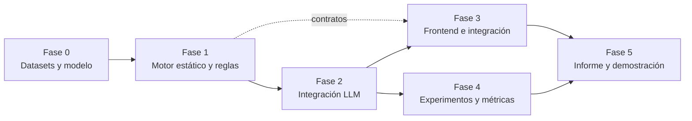

# Hoja de ruta

> No se fijan fechas. El cronograma debe ajustarse a las fechas oficiales del curso. La inicialización del repositorio (estructura y documentación) es el punto de partida y precede a la Fase 0.

## Fase 0 — Validación de datasets y modelo

- **Objetivo:** confirmar que los datos y el modelo candidatos son viables.
- **Dependencias:** ninguna.

### Fase 0A — Investigación documental y diseño (documentación preparada, pendiente de aprobación)

- **Actividades:** auditoría documental de las fuentes; diseño del dataset, del manifiesto y de las anotaciones; revisión de la taxonomía; diseño del piloto.
- **Entregables:** [dataset_audit.md](dataset_audit.md), [dataset_selection_plan.md](dataset_selection_plan.md), [pilot_plan.md](pilot_plan.md), taxonomía [v0.2 (B01–B07)](behavior_taxonomy.md), plantillas `datasets/metadata/manifest_template.csv` y `datasets/metadata/annotations_template.json`.
- **Criterios de aceptación:** el equipo aprueba el diseño y resuelve las decisiones pendientes listadas en el plan de selección.

### Fase 0B — Piloto del modelo y verificación de fuentes

> **Avance:** Ollama 0.40.13 instalado y piloto P1–P8 ejecutado con `qwen2.5-coder:7b` ([pilot_results.md](pilot_results.md)): 6 de 7 criterios cumplidos, falla el de etiquetas exactas (4/7). Estado de cierre en [phase0b_closure.md](phase0b_closure.md).
>
> **Decisiones de cierre (2026-11-01):**
> - **D1 adoptada:** desviación documentada [DEV-01](methodology.md#dev-01--inicio-de-la-fase-1a-sin-modelo-seleccionado-decisión-d1-2026-11-01). La Fase 1A puede empezar sin modelo seleccionado. Qwen2.5-Coder 7B queda solo como candidato provisional o línea base. **La selección del LLM es obligatoria antes de la Fase 2.**
> - **D3 adoptada:** las actividades no completadas se trasladan ([DEV-02](methodology.md#dev-02--traslado-de-actividades-de-la-fase-0b-decisión-d3-2026-11-01); tabla siguiente).
> - **D2 aprobada con observaciones:** las 20 anotaciones originales y la v0.2 completa, incluidos A-P021–A-P024, sustituciones y relaciones contextuales. Etiquetas y riesgos confirmados; histórico intacto y ausencia de segundo anotador documentada ([pilot_annotation_review.md](pilot_annotation_review.md)).
>
> **La Fase 0B está formalmente cerrada (autorización confirmada para el 2026-11-01).** Se conservan DEV-01, DEV-02 y la política estricta como principal (DEC-01). La Fase 1A se autorizó después en una solicitud separada; su estado actual se registra abajo. El acta histórica de cierre no se modifica.

**Actividades trasladadas (D3).** "Propietario" es el responsable del proyecto, que aprueba cada entregable; la ejecución puede contar con asistencia de IA bajo su supervisión.

| Actividad | Destino | Responsable | Depende de | Criterios de aceptación verificables |
|---|---|---|---|---|
| Ejemplos seguros complementarios para las pruebas del desofuscador | **Fase 1A** | Propietario (aprobación); equipo/AI-assist (redacción) | Cierre de la Fase 0B | Archivos `.ps1.txt` propios e inertes; solo dominios reservados y rutas inexistentes (prueba automática); SHA-256 registrado; marcados como fixtures y **no** usados como datos de evaluación; nunca se ejecutan (prueba estática); Pytest pasa |
| Scripts base de desarrollo y prueba para las reglas B01–B07, agrupados por familias | **Fase 1B** | Propietario | Fase 1A; decisiones de [dataset_selection_plan.md](dataset_selection_plan.md) §10 sobre el tope de tamaño, las listas sintácticas `dev`/`heldout`, los envoltorios neutros y las API de nube | 20–30 bases con `family_id`; etiquetas y anotaciones registradas antes de ejecutar ninguna configuración; partición por familias documentada (~50/50) con positivos de cada B01–B07 en ambos conjuntos, o la limitación documentada; anotaciones con revisión humana registrada (`verified_review`) |
| Construcción y congelación del dataset experimental definitivo y sus particiones | **Fase 4**, antes de la evaluación A/B/C | Propietario | Fase 1B; selección del LLM (DEV-01) | Manifiesto completo (hash, procedencia, familia, transformación, equivalencia); conjunto de prueba con `review_status = frozen` antes de los ajustes finales; archivo de SHA-256 verificado por una prueba; revisión de casi-duplicados documentada |
| Entorno aislado y procedimientos de inspección segura | **Prerrequisito** antes de usar cualquier muestra externa potencialmente peligrosa (p. ej., S3, Invoke-Obfuscation `v5`) | Propietario | Decisión sobre el estrato S3 ([dataset_selection_plan.md](dataset_selection_plan.md) §10) | Entorno documentado (VM o contenedor sin acceso a datos personales ni a la red de producción); procedimiento escrito de inspección **solo estática**; sin exclusiones de antivirus en el equipo personal ([security.md](security.md)); comprobado con un archivo inerte. **Mientras no exista, solo se usan scripts propios y controlados** |

- **Actividades:**
  - Definir el entorno aislado e inspeccionar en él las fuentes seleccionadas (contenido, duplicados, licencias pendientes).
  - Escribir los casos del piloto, con sus referencias en el manifiesto y en las anotaciones.
  - Instalar Ollama y correr el piloto con Qwen2.5-Coder 7B: JSON válido, comportamientos, evidencias, incertidumbre, prompt injection, estabilidad y latencia.
  - Comenzar a escribir y etiquetar los scripts base y asignar familias a desarrollo y prueba.
- **Entregables:** resultados del piloto con salidas crudas, decisión de modelo (tag y digest), prompt y esquema JSON versionados, primeras filas reales del manifiesto.
- **Criterios de aceptación:** el modelo cumple los criterios de viabilidad de [pilot_plan.md](pilot_plan.md#6-criterios-de-viabilidad-del-modelo) o se documenta el cambio de candidato; la partición por familias está documentada.

## Fase 1 — Motor estático y reglas

- **Objetivo:** implementar la configuración A.
- **Actividades:** esqueleto del backend; esquemas Pydantic; transformaciones de desofuscación con trazabilidad; reglas B01–B07; generador determinista de variantes; pruebas Pytest con muestras inertes.
- **Entregables:** servicios `deobfuscation` y `detection`, esquemas, suite de pruebas.
- **Criterios de aceptación:** pruebas pasan; ningún componente ejecuta código del script; límites de tamaño y profundidad aplicados.
- **Dependencias:** Fase 0 (taxonomía aprobada y criterios validados con el conjunto de desarrollo).
- **Subfases (decisiones D1 y D3, 2026-11-01):**
  - **Fase 1A — Desofuscador estático: aprobado, cerrado y publicado por el responsable dentro del subconjunto documentado.** API Python independiente; cuatro técnicas con recuperación acotada, `OT-FORMAT` detectada sin resolución, trazabilidad por capas, límites, fixtures inertes y 274 pruebas de referencia. [Cierre y situación de reproducibilidad CRLF/LF](phase1a_closure.md); [implementación y criterios](deobfuscator.md); [propuesta histórica](phase1_deobfuscator_proposal.md). Se conserva su implementación y la Fase 0B. La reproducción Linux sigue pendiente.
  - **Fase 1B — Aprobada técnicamente y cerrada formalmente por autorización expresa del responsable dentro del subconjunto de detección documentado.** API Python integrada con 1A, doce reglas B01–B07 parciales, evidencias contextuales verificables, indicios, deduplicación, cotas y demo inerte. 159 pruebas de implementación más 55 de auditoría; 488 aprobadas, también en la validación de cierre. P3/P7 permanecen como FN aceptados. [Cierre formal](phase1b_closure.md); [cobertura y límites](behavior_detector.md). Publicación pendiente por el propietario. Los scripts base/familias para evaluación final, particiones reservadas y el generador siguen pendientes; no se ejecutó el experimento A/B/C ni se inicia la Fase 2.

> **Piloto v2 (estado actual):** infraestructura experimental implementada y modelo descargado; seleccion interrumpida por recursos, sin aprobacion de calidad. La autorizacion del dataset es global, sin votos individuales ficticios. [Cierre operativo](phase_model_selection_closure.md).

## Fase 2 — Integración del LLM

**Estado: integración A/B/C implementada con LLM provisional.** La autorización expresa del responsable del 2026-11-02 establece DEV-03: permite desarrollo antes de concluir validación de calidad, sin aprobar el modelo ni alterar el piloto. [Arquitectura, uso y excepción prospectiva](phase2_integration.md); [pruebas y estado técnico real](phase2_closure.md). El piloto v2 sigue PENDIENTE / INCONCLUSO: 58 intentos, 68 llamadas de selección pendientes e incidencia de compromiso de 1,94 GiB; actas, resultados y hashes conservados. No se ejecuta de nuevo el piloto ni se activa otro candidato.

- **Objetivo:** implementar las configuraciones B y C y la validación de evidencias.
- **Actividades:** cliente Ollama; plantillas de prompt versionadas; parseo de salida estructurada; validador de evidencias; mitigaciones de prompt injection.
- **Entregables implementados:** contratos `schemas/pipeline.py`, servicios `services/pipelines/`, política de aplicación separada, CLI, controles de recursos, pruebas, persistencia explícita y comprobaciones funcionales locales. Los servicios/prompts históricos del piloto no se modifican.
- **Criterios de aceptación:** B y C generan salidas válidas según el esquema; las afirmaciones no respaldadas se detectan; modelo y parámetros quedan registrados.
- **Dependencias:** Fase 1. DEV-03 exceptúa únicamente el bloqueo de desarrollo de DEV-01; la selección/validación de calidad permanece pendiente con sus criterios sin cambios y es distinta del funcionamiento del software. La evaluación final no se declara autorizada ni completada por esta integración.

## Fase 3 — Frontend e integración

- **Objetivo:** interfaz web para analizar y visualizar resultados.
- **Actividades:** proyecto Vite + React + TypeScript + Tailwind; editor de código; vistas de hallazgos y evidencias; endpoints FastAPI; integración extremo a extremo.
- **Entregables:** aplicación web funcional en local.
- **Criterios de aceptación:** un script de ejemplo inerte puede analizarse de punta a punta; ninguna lógica de análisis ni credencial reside en el navegador.
- **Dependencias:** contratos de la Fase 1 (puede avanzar en paralelo una vez definidos); Fase 2 para la integración completa.

## Fase 4 — Experimentos y métricas

- **Objetivo:** evaluar H1 y H2.
- **Actividades:** construir y congelar el dataset experimental definitivo y sus particiones (trasladado desde la Fase 0B, D3); congelar prompts y modelo; ejecutar A/B/C; calcular métricas (evidencias: política estricta como principal); revisión semántica manual; repeticiones para estabilidad.
- **Entregables:** resultados en `experiments/results/`, scripts de evaluación, tablas y figuras.
- **Criterios de aceptación:** resultados reproducibles a partir de la configuración registrada; el conjunto de evaluación no se modificó tras la congelación.
- **Dependencias:** Fases 0, 1 y 2, y LLM seleccionado (DEV-01). No se ejecuta ningún experimento comparativo definitivo A/B/C con el candidato provisional.

## Fase 5 — Informe y demostración

- **Objetivo:** comunicar resultados.
- **Actividades:** redacción del informe (metodología, resultados, limitaciones); preparación de la demostración con muestras inertes; actualización del README.
- **Entregables:** informe final, presentación, demostración.
- **Criterios de aceptación:** las conclusiones se sustentan en los resultados obtenidos, incluidos los negativos.
- **Dependencias:** Fases 3 y 4.
